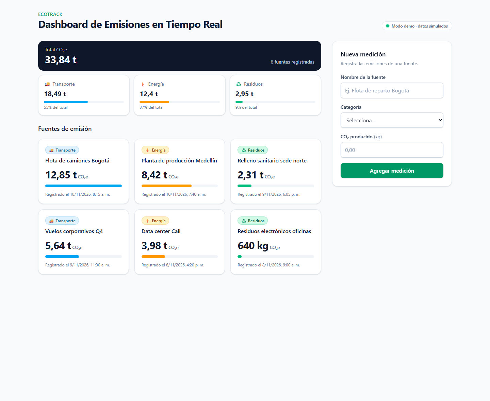
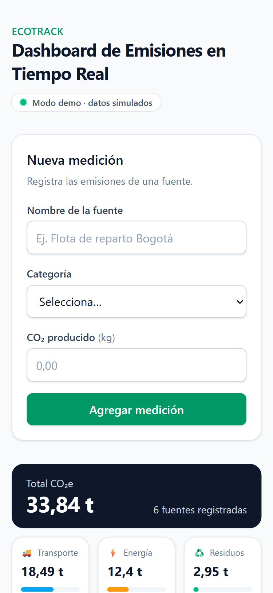
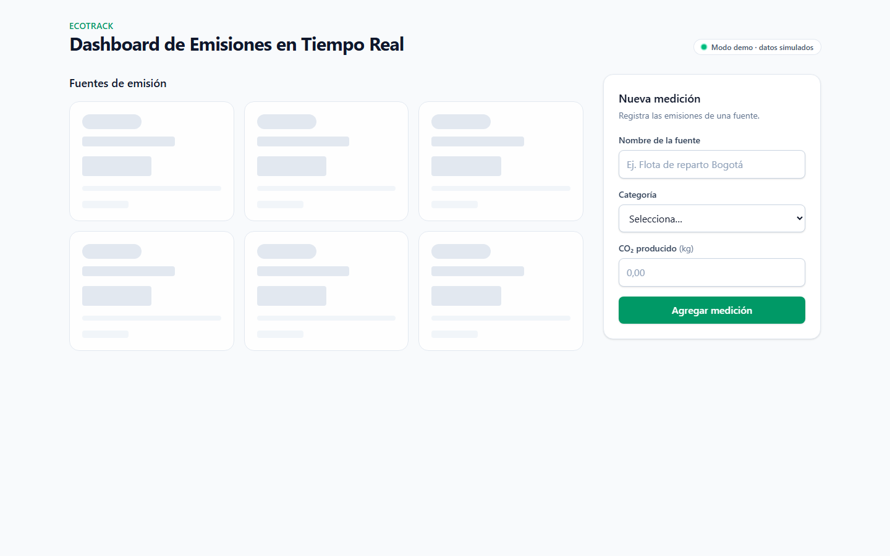
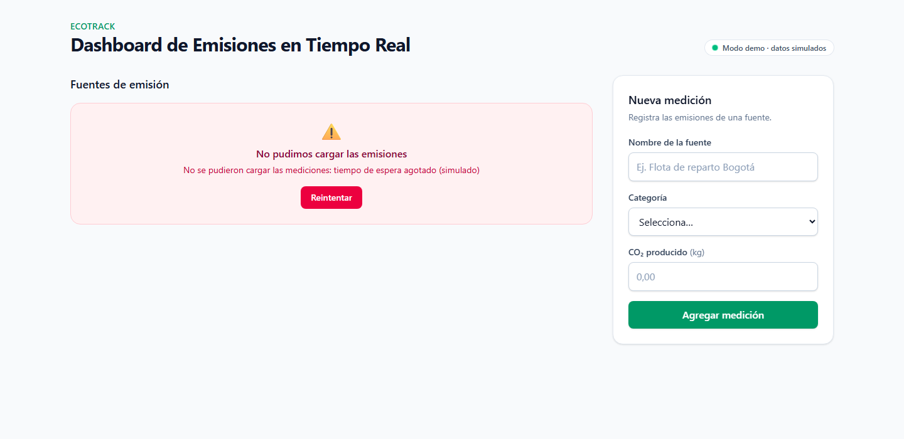
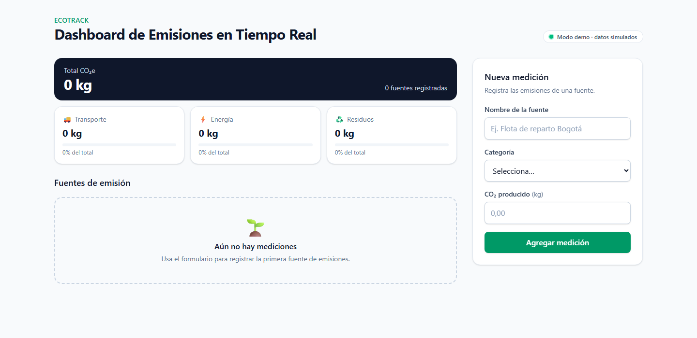
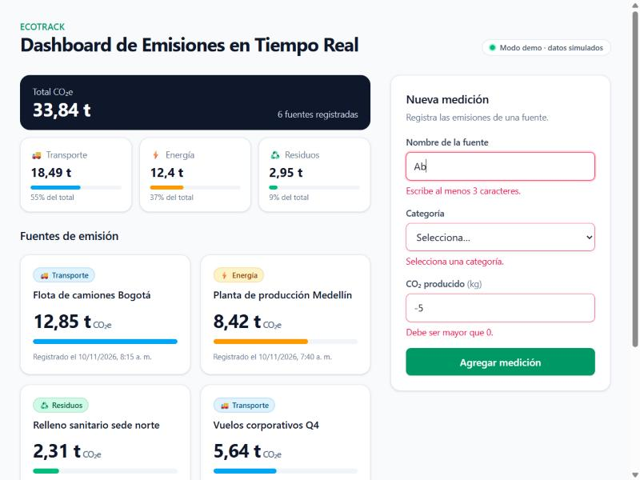
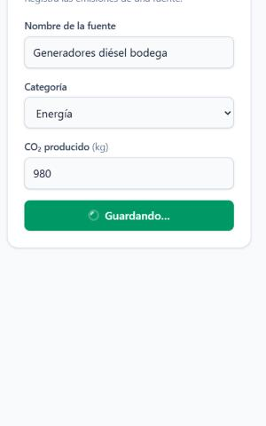
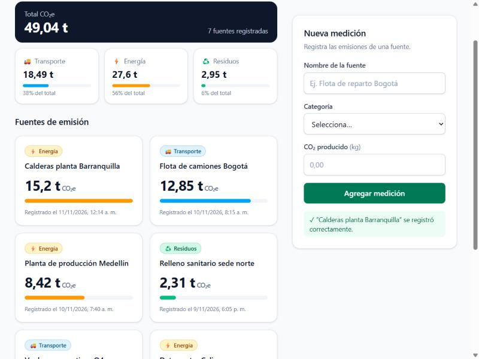
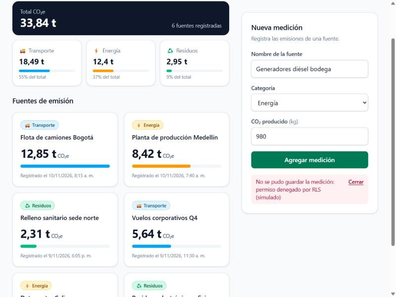

# EcoTrack · Dashboard de Emisiones en Tiempo Real 🌍

Proyecto Integrador **"El Ciclo Spec-to-Code en Acción"**: el componente `EmissionsTracker` y el hook `useEmissions`, construidos con **React 19 + TypeScript (strict) + Vite + Tailwind CSS v4 + Supabase**, a partir de una especificación y refinando la salida de la IA en varias iteraciones.



## 📦 Entregables

| Entregable | Dónde |
|---|---|
| Bitácora de prompts (4 prompts + evolución del código) | [`docs/BITACORA_PROMPTS.md`](docs/BITACORA_PROMPTS.md) |
| Componente `EmissionsTracker.tsx` | [`src/components/EmissionsTracker/EmissionsTracker.tsx`](src/components/EmissionsTracker/EmissionsTracker.tsx) |
| Hook `useEmissions.ts` | [`src/hooks/useEmissions.ts`](src/hooks/useEmissions.ts) |
| Configuración de Supabase | [`src/lib/supabase.ts`](src/lib/supabase.ts), [`src/services/`](src/services), [`supabase/migrations/`](supabase/migrations) |
| Capturas de la demo | [`docs/capturas/`](docs/capturas) (y abajo) |

## 🏗️ Arquitectura

```
EmissionsTracker (contenedor: decide qué estado mostrar)
├── EmissionsSummary     → total CO₂e + % por categoría   (memo)
├── EmissionCard[]       → nombre, categoría, CO₂          (memo)
├── EmissionForm         → validación + feedback accesible
└── LoadingGrid / ErrorState / EmptyState
          │
          ▼
useEmissions(repository)   ← useReducer + useMemo + Realtime
          │
          ▼
EmissionsRepository (interfaz)
├── supabaseEmissionsRepository  → @supabase/supabase-js (cliente único)
└── mockEmissionsRepository      → datos simulados (modo demo)
```

```text
src/
├── components/EmissionsTracker/
│   ├── EmissionsTracker.tsx   # Componente principal
│   ├── EmissionCard.tsx       # Tarjeta de cada fuente
│   ├── EmissionForm.tsx       # Formulario de nueva medición
│   ├── EmissionsSummary.tsx   # Totales por categoría
│   ├── Spinner.tsx
│   └── states.tsx             # Skeleton, error con reintento, vacío
├── hooks/useEmissions.ts      # Lógica: carga, inserción, errores, realtime
├── services/                  # Repositorios Supabase y mock
├── lib/supabase.ts            # Cliente único de Supabase
├── types/                     # Modelo de dominio + tipos de la BD
├── constants/categories.ts    # Etiquetas, iconos y colores por categoría
└── utils/                     # Formato es-CO y validación pura
```

**Decisiones clave:**
- **Lógica fuera de la UI:** los componentes no conocen Supabase; todo pasa por `useEmissions`.
- **Inyección de dependencias:** `useEmissions(repository)` funciona igual con Supabase o con el mock.
- **Máquina de estados:** `useReducer` con unión discriminada; la carga de la lista y el envío del formulario tienen estados separados.
- **Rendimiento:** totales con `useMemo`, tarjetas con `React.memo` y callbacks estables con `useCallback`.
- **Tiempo real:** suscripción a `INSERT` con Supabase Realtime, sin duplicados por `id`.
- **Accesibilidad:** labels con `useId`, `aria-invalid`/`aria-describedby`, foco al primer error, `aria-live` y `role="alert"`.

## ▶️ Ejecutar

```bash
npm install
npm run dev
```

Sin `.env` la app arranca en **modo demo** con datos simulados. Escenarios de demo por URL:

| URL | Muestra |
|---|---|
| `/` | Dashboard con datos |
| `/?mock=slow` | Skeleton de carga |
| `/?mock=error` | Error de carga + botón Reintentar |
| `/?mock=empty` | Estado vacío |
| `/?mock=insert-error` | Error al guardar una medición |

### Conectar con Supabase real

1. Ejecuta [`supabase/migrations/20261111120000_create_emissions.sql`](supabase/migrations/20261111120000_create_emissions.sql) en el SQL Editor (crea la tabla, RLS y Realtime).
2. Copia `.env.example` a `.env` con tu `VITE_SUPABASE_URL` y `VITE_SUPABASE_ANON_KEY`.
3. `npm run dev`: el indicador cambia a **"Conectado a Supabase · Realtime"**.

## 📸 Capturas

| Escritorio | Móvil (375px) |
|---|---|
|  |  |

| Cargando (skeleton) | Error con reintento | Sin datos |
|---|---|---|
|  |  |  |

| Validación del formulario | Guardando… | Medición agregada | Error al guardar |
|---|---|---|---|
|  |  |  |  |

## Scripts

| Comando | Descripción |
|---|---|
| `npm run dev` | Servidor de desarrollo |
| `npm run build` | `tsc -b` (strict) + build de producción |
| `npm run lint` | oxlint |
